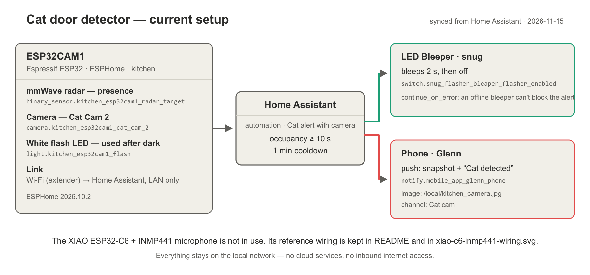
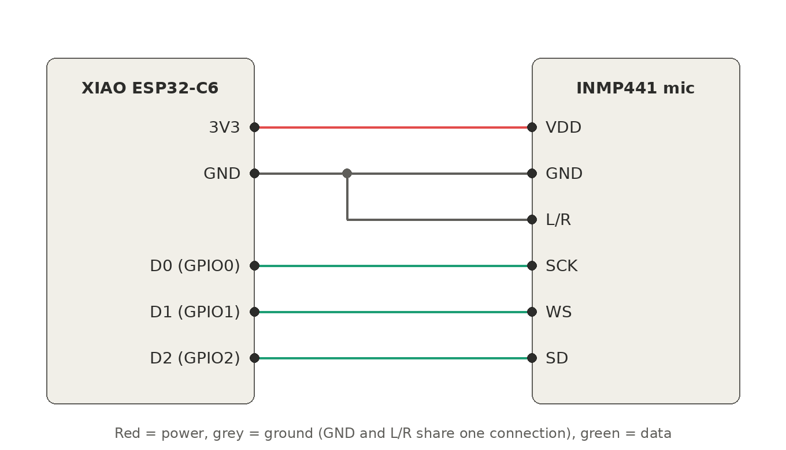

# Cat door detector

Goal: tell me on my phone when the cat is at the front door meowing to come in.

## How it works (current, 2026-11-24)

1. ESP32CAM1 (ESPHome, kitchen) watches the door with a mmWave presence radar
   (`binary_sensor.kitchen_esp32cam1_radar_target`) and a camera
   (`camera.kitchen_esp32cam1_cat_cam_2`). The radar's `Radar Target` sensor has
   a 15 s `delayed_off` filter so brief dropouts don't reset the 30 s dwell.
2. `automation.cat_alert_with_camera` fires after **30 s of continuous presence**,
   so someone walking quickly through the hallway doesn't trigger it. It runs
   only between **08:00 and 22:00** (time condition), so it stays quiet overnight.
3. On fire it:
   - after dark, flashes `light.kitchen_esp32cam1_flash` at 100 % and waits 12 s
     for the camera's auto-exposure to settle so the snapshot is usable,
   - takes a snapshot to `/config/www/kitchen_camera.jpg`,
   - turns the flash back off,
   - bleeps the LED Bleeper in the snug for **2 s**
     (`switch.snug_flasher_bleaper_flasher_enabled`, `continue_on_error` so an
     offline bleeper can't block the phone alert),
   - pushes the snapshot to both phones (`notify.mobile_app_glenn_phone` and
     `notify.mobile_app_helen_phone`, channel "Cat cam").
4. Then a **5 minute cooldown**: a template condition on `last_triggered`
   checked up front (plus `mode: single`). The long cooldown treats repeated
   in/out bursts at the door as one visit, so you get a single alert instead of
   several identical notifications.

Everything is LAN-only; the phone fetches the image from `/local/kitchen_camera.jpg`.
The notification URL adds a `?t=<unix timestamp>` cache-buster so the phone
downloads the new snapshot instead of showing a cached image from an earlier alert.

[Editable SVG source](wiring/live-setup.svg)

## Original mic design (not in use)

1. A XIAO ESP32-C6 with an INMP441 I2S microphone runs ESPHome and reports
   loudness (`sound_level`) to Home Assistant over Wi-Fi.
2. A Home Assistant automation triggers when the loudness goes above a threshold
   (later: and a presence sensor sees something on the doorstep).

Everything stays on the LAN; no inbound internet access is needed.

Limitation: the mic only measures loudness, so it cannot tell a meow from other
loud noises. Adding a doorstep presence sensor is meant to cut false alarms.
A camera with Frigate audio detection (which can classify "meow") is the fallback if that is not enough.

The ESPHome mic device is not present in Home Assistant at all, so this path is
dormant: `automation.cat_detected_bleep` references the mic entities
`sensor.esphome_cat_peak_loudness` and `binary_sensor.esphome_cat_radar_target`,
which do not exist in HA. The Snug flasher/bleeper switch does exist and is used
by the live radar automation, but this mic automation does not run. It last fired
2026-10-28.

### Reference wiring (mic, not in use)

| INMP441 | XIAO ESP32-C6 |
|---|---|
| VDD | 3V3 (not 5V) |
| GND | GND |
| L/R | GND (left channel) |
| SCK | D0 (GPIO0) |
| WS | D1 (GPIO1) |
| SD | D2 (GPIO2) |

Pin mapping verified against Seeed's XIAO ESP32-C6 pinout: D0 = GPIO0, D1 = GPIO1,
D2 = GPIO2. Matches the ESPHome device config (`i2s_bclk_pin: GPIO0`,
`i2s_lrclk_pin: GPIO1`, `i2s_din_pin: GPIO2`).

## Hardware

- ESP32CAM1 - ESP32 board with mmWave presence radar, camera and white flash LED (kitchen)
- LED Bleeper - ESP32-C6 flasher/bleeper in ESPHome (snug)
- Seeed Studio XIAO ESP32-C6 (board setting `esp32-c6-devkitc-1`) - not in use
- INMP441 I2S digital microphone (assumed model) - not in use
- Planned: 3D-printed weatherproof case

## Files

- [wiring/live-setup.png](wiring/live-setup.png) / [.svg](wiring/live-setup.svg) - current setup diagram
- [wiring/xiao-c6-inmp441-wiring.png](wiring/xiao-c6-inmp441-wiring.png) / [.svg](wiring/xiao-c6-inmp441-wiring.svg) - mic reference wiring
- [automations/automation-cat-alert-with-camera.yaml](automations/automation-cat-alert-with-camera.yaml) - live automation (export)
- [automations/automation-cat-detected-bleep.yaml](automations/automation-cat-detected-bleep.yaml) - dormant mic automation (export)

## Status

_Last synced with the live HA instance on 2026-11-24._

- [x] Radar + camera detection live: 30 s presence bleeps the snug LED Bleeper for 2 s and pushes a snapshot to both phones, 08:00-22:00 only
- [x] Presence detection added: mmWave radar in ESP32CAM1
- [x] XIAO C6 flashed and joined the extender Wi-Fi (device not currently in Home Assistant)
- [ ] Mic wired up and loudness readings checked
- [ ] Loudness threshold tuned for the front door
- [ ] Case designed, printed and mounted
- [ ] Later: battery power (the always-on mic and mmWave sensor use a lot of power)
